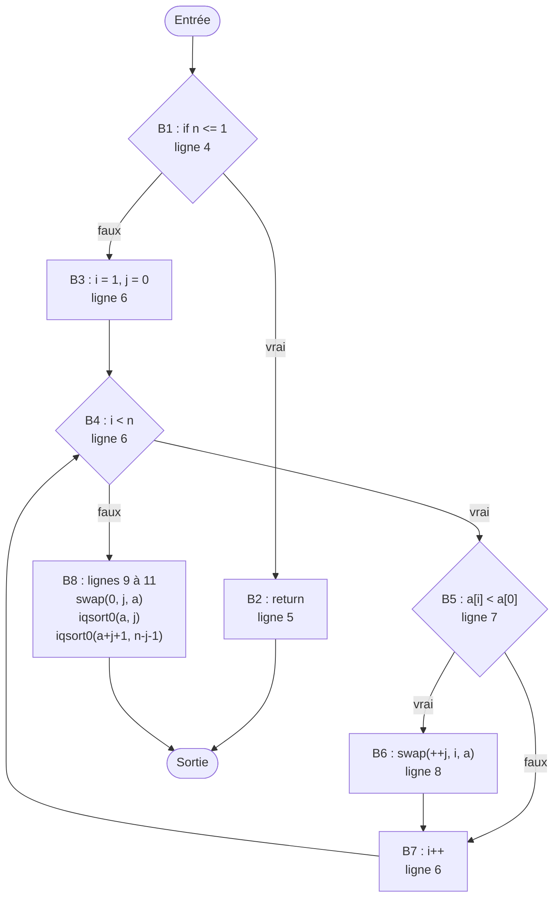

# Equipe

- ALLARD Loan
- CANTOR Romain
- CHETIOUI Willem

---

## 2.4 Mesurer un algorithme simple

### Code source analysé

Implémentation simplifiée du QuickSort :

```c
 1  void iqsort0(int *a, int n)
 2  {
 3      int i, j;
 4      if (n <= 1)
 5          return;
 6      for (i = 1, j = 0; i < n; i++)
 7          if (a[i] < a[0])
 8              swap(++j, i, a);
 9      swap(0, j, a);
10      iqsort0(a, j);
11      iqsort0(a + j + 1, n - j - 1);
12  }
```

---

### Graphe de flot de contrôle (CFG)



## 2.5 Complexité cyclomatique

---

### Nombre de nœuds **N** (B1 à B8 + Sortie) = 9

### Nombre d'arêtes **E** = 11

### Composantes connexes **P** = 1

---

### $$V(G) = E - N + 2P = 11 - 9 + 2 = \mathbf{4}$$

### **Vérification par les prédicats** : le code contient 3 points de décision (`if (n <= 1)`, `i < n`, `if (a[i] < a[0])`), donc V(G) = 3 + 1 = **4**.

### Le nœud d'entrée n'est pas compté ici. L'ajouter donnerait N = 10 et E = 12, et le résultat resterait identique.

### **Interprétation** : il existe 4 chemins linéairement indépendants dans `iqsort0`. Il faut donc au minimum 4 cas de test pour couvrir la base de chemins. Une valeur de 4 correspond à une fonction simple, peu risquée et facile à tester.

## 2.6 Métriques de Halstead

---

### Convention de comptage (CM, slides 43-44)

- **Opérateurs** : éléments de contrôle (`if`, `for`, `return`), déclarations (fonction, type `int`, pointeur `*`), opérateurs d'affectation, arithmétiques, relationnels et d'indexation.
- **Opérandes** : variables, constantes et **appels de procédures** (`swap`, `iqsort0`), y compris les occurrences dans les déclarations.
- **Ponctuation non comptée** : `( ) { } ; ,` sont des délimiteurs syntaxiques qui n'agissent sur aucune variable.
- `++j` et `i++` sont comptés comme un même opérateur distinct `++`.

---

### Opérateurs

| Opérateur                                   | Occurrences | Lignes    |
| ------------------------------------------- | :---------: | --------- |
| `void iqsort0(…)` (déclaration de fonction) |      1      | 1         |
| `int` (déclaration de type)                 |      3      | 1 (×2), 3 |
| `*` (déclaration de pointeur)               |      1      | 1         |
| `if`                                        |      2      | 4, 7      |
| `return`                                    |      1      | 5         |
| `for`                                       |      1      | 6         |
| `=`                                         |      2      | 6 (×2)    |
| `<=`                                        |      1      | 4         |
| `<`                                         |      2      | 6, 7      |
| `++`                                        |      2      | 6, 8      |
| `[ ]` (indexation)                          |      2      | 7 (×2)    |
| `+`                                         |      2      | 11 (×2)   |
| `-`                                         |      2      | 11 (×2)   |
| **Total**                                   |   **22**    |           |

### Opérandes

| Opérande          | Occurrences | Lignes                  |
| ----------------- | :---------: | ----------------------- |
| `a`               |      7      | 1, 7 (×2), 8, 9, 10, 11 |
| `n`               |      4      | 1, 4, 6, 11             |
| `i`               |      6      | 3, 6 (×3), 7, 8         |
| `j`               |      7      | 3, 6, 8, 9, 10, 11 (×2) |
| `0`               |      3      | 6, 7, 9                 |
| `1`               |      4      | 4, 6, 11 (×2)           |
| `swap` (appel)    |      2      | 8, 9                    |
| `iqsort0` (appel) |      2      | 10, 11                  |
| **Total**         |   **35**    |                         |

---

### Résultats

| Mesure                   | Formule                                                           |    Valeur    |
| ------------------------ | ----------------------------------------------------------------- | :----------: |
| Opérateurs distincts     | $n_t$                                                             |      13      |
| Occurrences d'opérateurs | $N_t$                                                             |      22      |
| Opérandes distincts      | $n_d$                                                             |      8       |
| Occurrences d'opérandes  | $N_d$                                                             |      35      |
| Longueur                 | $N = N_t + N_d$                                                   |    **57**    |
| Vocabulaire              | $n = n_t + n_d$                                                   |    **21**    |
| Volume                   | $V = N \times \log_2 n = 57 \times \log_2 21$                     |  **250,36**  |
| Difficulté               | $D = \frac{n_t}{2} \times \frac{N_d}{n_d} = 6{,}5 \times 4{,}375$ |  **28,44**   |
| Effort                   | $E = D \times V$                                                  | **7 119,67** |

### **Interprétation** : le volume (≈ 250) reste modeste, ce qui est cohérent avec une fonction courte. La difficulté est en revanche assez élevée pour sa taille : peu d'opérandes distincts sont réutilisés très souvent (`a` et `j` apparaissent 7 fois chacun), ce qui demande de suivre leur valeur tout au long de l'algorithme.

### Ces valeurs dépendent directement de la convention choisie : compter la ponctuation ou les types, ou considérer les appels comme des opérateurs, change tous les résultats.

## 2.7 Validité des métriques de Halstead

---

### Définition d'une mesure valide (Définition du cours)

Une mesure $M : A \to B$ est **valide** par rapport à un système empirique $E = (A, \{R_1, \dots, R_n\})$ si toute relation empirique entre deux entités se retrouve entre leurs mesures :

$$\forall (a, b) \in R,\ (M(a), M(b)) \in S$$

Si un programme `a` est réellement plus complexe qu'un programme `b`, il faut donc que $M(a) > M(b)$. Cela suppose que $M$ associe une seule valeur à chaque programme et que l'ordre des valeurs respecte celui réellement constaté.

---

### 1. Le comptage dépend d'une convention arbitraire

La distinction entre opérateur et opérande n'est pas définie, rien n'impose de compter ou non la ponctuation, les types, ou de classer les appels de fonction d'un côté plutôt que de l'autre. Pour le même code `iqsort0` :

| Mesure        | Ponctuation non comptée (2.6) | Ponctuation comptée |
| ------------- | :---------------------------: | :-----------------: |
| $n_t$ / $N_t$ |            13 / 22            |       17 / 48       |
| Volume V      |            250,36             |       385,44        |
| Difficulté D  |             28,44             |        37,19        |
| Effort E      |           7 119,67            |      14 333,55      |

### Un même programme n'a donc pas une valeur unique. Selon la personne qui mesure, l'effort varie du simple au double. $M$ n'est alors pas une application bien définie et la première condition de validité n'est pas garantie.

### La convention peut même inverser une relation empirique. Écrire `(a + j) + 1` au lieu de `a + j + 1` rend le code au moins aussi lisible, mais si l'on compte les parenthèses $N$ et $V$ augmentent, la mesure indique plus complexe alors que ce n'est pas le cas. De même, `int i, j;` et `int i; int j;` sont équivalents, mais ils ne donnent pas le même $N_t$.

---

### 2. Les formules ne reposent pas sur des relations empiriques démontrées

Les comptages ($n_t$, $N_t$, $n_d$, $N_d$) et la longueur $N$ restent des mesures de taille assez intuitives. Un programme plus long a plus de symboles. En revanche rien ne justifie expérimentalement les formules du volume, de la difficulté et de l'effort.

### Or une relation empirique doit s'appuyer sur des preuves vérifiables, comme des résultats expérimentaux. Sans ces preuve, on ne peut pas affirmer qu'un programme avec une difficulté $D$ plus élevée est réellement plus difficile à comprendre. La relation plus difficile que n'est pas démontrée comme étant préservée par $D$, ni demande plus d'effort que par $E$.

---

### **Conclusion** : Les métriques de Halstead sont difficiles à justifier à deux niveaux, le comptage et les formules. On ne peut donc pas garantir que l'ordre qu'elles donnent entre deux programmes reflète l'ordre réel de complexité, ce qui met en doute leur validité au sens de la théorie de la mesure. C'est pour cela qu'elles sont rarement utilisées seules, mais combinées à d'autres mesures, par exemple dans l'Index de Maintenabilité. (Basé sur l'analyse précédente et le cours)

## 2.9 Points de fonction du QuickSort

---

### Poids

Chaque poids est le produit d'une base par catégorie (effort relatif d'une interaction) et d'un niveau de difficulté (simple = 1, moyen = 2, difficile = 3) :

| Catégorie         | Base | Justification                                              |
| ----------------- | :--: | ---------------------------------------------------------- |
| Entrées externes  |  1   | Référence : recevoir une donnée de l'appelant              |
| Requêtes externes |  1   | Une entrée suivie d'une réponse immédiate, sans traitement |
| Sorties externes  |  2   | Le résultat doit être calculé avant d'être fourni          |
| Fichiers externes |  2   | Accès à des données via un mécanisme externe               |
| Fichiers internes |  3   | Structure de données à concevoir et à maintenir            |

### Scores pour `iqsort0`

- **Entrées externes** : `n`, un entier (simple), et `a`, le tableau à trier (moyen).
- **Sorties externes** : Le tableau trié (difficile, car il est produit par toute la logique de partition et de récursion).
- **Requêtes, fichiers internes et externes** : Aucun. Le tri se fait en mémoire, sur le tableau fourni par l'appelant.

### $$UFC = 1 \times 1 + 2 \times 1 + 6 \times 1 = \mathbf{9}$$

### **Interprétation** : Le score est très faible alors que l'algorithme n'est pas trivial. Les points de fonction mesurent les interactions avec l'extérieur, indépendamment de la complexité du code. Ils sont donc peu adapté à un algorithme comme le QuickSort, dont toute la difficultée est interne.

## 2.10 Index de Maintenabilité (MI)

---

### Valeurs utilisées pour `iqsort0`

| Mesure                       | Valeur | Source                                |
| ---------------------------- | :----: | ------------------------------------- |
| Volume d'Halstead (HV)       | 250,36 | Onglet Halstead (2.6)                 |
| Complexité cyclomatique (CC) |   4    | Onglet CC (2.5)                       |
| Lignes de code (LOC)         |   12   | `loc.sh` sur le code de `iqsort0`     |
| Commentaires (COM)           |  0 %   | Le code ne contient aucun commentaire |

### Calcul (CM, slide 54)

$$MI = 171 - 5{,}2 \ln(HV) - 0{,}23\,CC - 16{,}2 \ln(LOC) + 50 \sin\sqrt{2{,}46 \times COM}$$

$$MI = 171 - 28{,}72 - 0{,}92 - 40{,}26 + 0 = \mathbf{101{,}11}$$

### **Interprétation** : Le score dépasse le haut de l'échelle de 1 à 100, ce qui traduit une fonction très facile à maintenir. Elle est courte, peu complexe et de faible volume. Sans commentaire, le dernier terme est nul.
